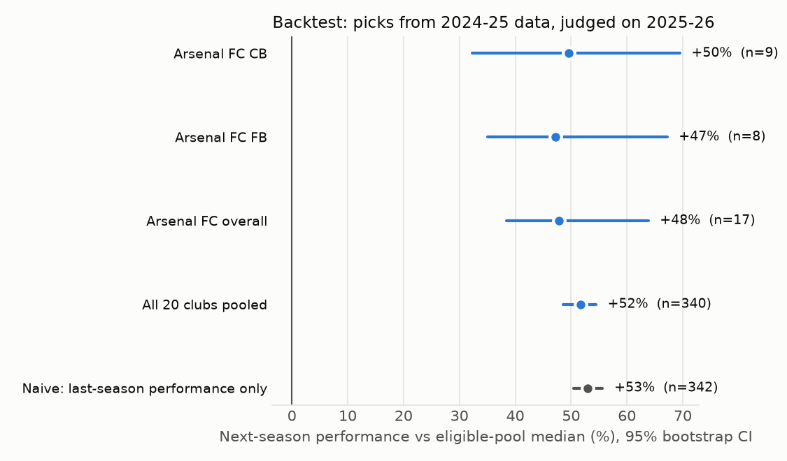
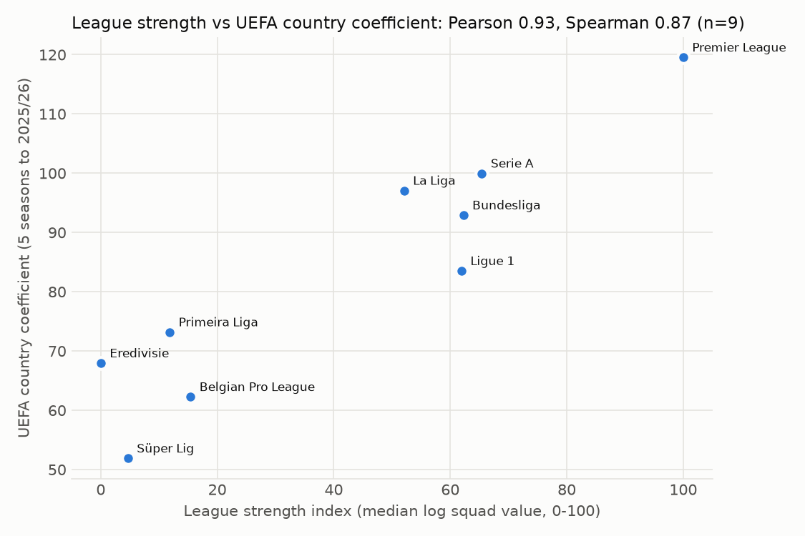

# AI Scout — explainable football recruitment

**From a squad weakness to a shortlist you can inspect.** AI Scout helps explore where a Premier League club needs reinforcement, which players fit its brief, and why. It covers players from 10 European leagues in a five-page Streamlit dashboard.

> **Project status:** Available locally on `main`. The app includes Candidate A need scoring, evidence coverage, upgrade checks, and 20 regenerated West Ham scouting reports. Four of five need-calibration checks pass; the remaining failure is documented below. Public deployment is pending.

## Explore the product

1. **Home:** Set the recruitment brief: club, ambition, market-value limit, and age range. In the Live view the ambition is pre-selected from the club's place in the current league table; you can change it.
2. **Squad needs:** See where the club stands now (position, points, xG for and against, full table), then inspect quality shortfall, depth, age and contract urgency, ambition benchmarks, and rated-minute coverage. Grey badges identify insufficient evidence.
3. **Player targets:** Compare position-specific fit, upgrade margin against the current best rated regular, and ambition-benchmark warnings.
4. **Scouting report:** Read a cached summary, strengths, and risks with fact-key citations and verification results.
5. **Evaluation:** Inspect need calibration, report faithfulness, backtesting, sensitivity, league strength, and the frozen quality experiment.

The analytics make the decisions. Deterministic pandas functions calculate needs, rankings, and verdicts; the LLM only explains a supplied fact sheet. Its numeric claims and cited fact keys are checked before a report is shown.

## Results at a glance

The evaluation uses 2025–26 statistics and the 2026-07-06 squad/value snapshot; the app defaults to live squads and values refreshed weekly (see *Live squads, values and table*). Backtesting uses 2024–25 → 2025–26. The West Ham/title case study and all 20-club acceptance tables are in [NEEDS_IMPLEMENTATION.md](docs/NEEDS_IMPLEMENTATION.md); [NEEDS_DIAGNOSIS.md](docs/NEEDS_DIAGNOSIS.md) preserves the earlier diagnosis.

| Check | Current finding |
|---|---|
| Need calibration | **4/5 pass.** PPG correlation is **−0.369**, failing the required ≤−0.6. Goal difference: −0.555; market value (secondary, non-independent): −0.716. |
| Ambition and evidence | Zero decreases / 420 comparisons; 132/135 used cells have sufficient evidence (97.8%). |
| Level meaning | At title, 46.7% of used cells are Medium/High; at survive, 1.5%. Arsenal and Manchester City have zero High positions at title. |
| Reports | V0 prompt v2: **278/278 numeric claims verified (100.0%)** across 20 reports; 0 regenerated once, 0 flagged. Free API access verified; model/unit judgments still need review. [Examples and citations](docs/REPORT_EXAMPLES.md). |
| Backtest | Pooled uplift **+51.7%** (95% CI 48.6% to 54.5%; 340/439 scored). |
| Simple baseline | **Still better on next-season output:** +53.0% uplift; median outcome 80.1 vs model 79.5. |
| Cost proxy | Median value €18m model vs €30m baseline; both median age 24. |
| Stability | Mean league top-ten Jaccard across ten variants 0.856 (previously 0.849); floor −0.1 worsened from 0.843 to 0.656. |
| League-strength check | UEFA five-season Pearson 0.933 / Spearman 0.867 across nine leagues. ClubElo's single retry returned 502; its correlation is unavailable. |

No parameters were tuned after seeing acceptance results. The completed implementation and experiment are committed on `main`; the failed calibration check remains an explicit limitation. Backtest selection grew from 400 to 439 picks, so the before/after figures are pipeline comparisons over different selections, not paired causal improvements. Validation: **93 tests passed**, Ruff clean, and all five Streamlit pages passed checks with and without report access.






### Pre-registered quality experiment

V0 is retained under the stop rule. V1 selected six stats per position solely by player repeatability and possession correlation; it failed PPG calibration more severely (rho +0.207 vs V0 −0.369, requirement ≤−0.6). Both pass a/c/d/e. V1 reduced top-six-value-club shortlist bias (10% → 5%) and increased experiment backtest uplift (51.17% → 56.87%), but this does not establish better need calibration. V2 could not run because Sofascore ratings were inaccessible. No further variants or threshold changes were made. Full selection tables and frozen protocol: [QUALITY_EXPERIMENT.md](docs/QUALITY_EXPERIMENT.md); [results](docs/QUALITY_EXPERIMENT_RESULTS.md). Calibration (b) remains a documented limitation.

## How it works

```text
Offline pipeline                           Streamlit app
FotMob + Transfermarkt                     Choose club, ambition, budget, ages
        ↓                                          ↓
Clean data + cross-source identity map      Recompute needs and shortlists
        ↓                                          ↓
League-adjusted player features             Inspect player facts and cached reports
        ↓
Processed data → needs → rankings → grounded reports → evaluation
```

The app reads prepared files from `data/processed/`; it does not scrape during a session. Changing the brief recomputes needs and rankings with the same deterministic functions used by the offline pipeline. Reports are generated from a bounded fact sheet, checked against it, and cached by a hash of the facts, prompt text, prompt version, and model.

### Data and decisions

- **Coverage:** FotMob season statistics and team possession for 2024–25 and 2025–26 across the Premier League, La Liga, Bundesliga, Serie A, Ligue 1, Primeira Liga, Eredivisie, Belgian Pro League, EFL Championship, and Süper Lig. A Transfermarkt dataset snapshot supplies identity, club, contract, and market-value data for nine leagues; FotMob player profiles bridge the Championship. A weekly live overlay replaces clubs, squads and market values with FotMob's current ones (below). The cross-source match covers **99.79% of minutes** in the nine Transfermarkt leagues. [Data audit](docs/DATA_REALITY.md).
- **Player features:** Per-90 statistics are adjusted for league strength; defensive volume is also adjusted for team possession. Players must meet the minute and match thresholds before position-group percentiles are calculated across the 10 leagues.
- **Squad needs:** Need = shortfall against the selected ambition (primary), plus depth, age and contract urgency within the remaining range (secondary). N = Q + (1−Q/100) × (0.20D+0.15A+0.15C). Bands remain 35/60. Combined squad profiles use the unchanged pool; ≥600-minute non-pool players can be placed on it. Under 50% fully rated minutes produces a grey insufficient-evidence badge and excludes that position from ranking. Missing stats are never invented. The current league table never enters the score: it is shown as context and only pre-selects the ambition (below).
- **Targets:** Eligible players match the position, age, and market-value brief. They must beat the best current rated regular by ≥5 weighted percentile points. Fit combines need-weighted performance, age, and value; title/top4 benchmark deficits are flagged. The ranking and verdict are computed, not authored by the LLM.
- **Reports:** The LLM writes a summary, strengths, and risks from a fact sheet. Numeric claims must match facts and cited keys must exist; a failed report is retried once and then flagged.

### Live squads, values and table

Every Monday a GitHub Action ([`live-refresh.yml`](.github/workflows/live-refresh.yml)) runs `python pipeline.py --stage live` and commits `data/processed/live/`. The stage reads FotMob's current-season table for all 10 leagues (clubs, position, points, goals, xG and xG against), every club's squad page (club, birth date, SciSports market value), and the contract end date of every target-league squad player who has 2025–26 stats. Statistics, percentiles and league strength stay those of the 2025–26 season until the new season has enough matches; only club, league membership, market value, age and contract move. Promoted and relegated clubs therefore follow FotMob's current table. Players who are in no tracked squad (moved abroad, released) keep their frozen value and are shown without a current club. SciSports values are used unscaled: on 483 players valued by both sources the median Transfermarkt/SciSports ratio was 1.001.

In the Live view the sidebar suggests an ambition from the target club's place in the table: the most ambitious level whose benchmark place (1st, 4th, 10th, 17th) is within 0.3 points per match played of the club (3 points after 10 matches), otherwise *stay in the league*. There is no suggestion before 5 matches. Margin and minimum matches are set in `settings.yaml` (`live`). The suggestion only sets the benchmark the user can already choose, so the need formula and its evaluation are unchanged. Feeding results into the score itself is deferred until statistics switch to 2026–27, when it can be backtested on dated tables rebuilt from past seasons.

The sidebar switches between **Live** and **Frozen snapshot** (2026-07-06). Evaluation, the backtest and the West Ham case study use the frozen snapshot. A second weekly Action ([`tm-snapshot-check.yml`](.github/workflows/tm-snapshot-check.yml)) opens an issue when transfermarkt-datasets publishes data newer than the snapshot.

Weights, thresholds, and league settings live in [`config/settings.yaml`](config/settings.yaml). The decision code is in [`src/scout/needs.py`](src/scout/needs.py), [`src/scout/rank.py`](src/scout/rank.py), and [`src/scout/report.py`](src/scout/report.py).

## Limitations

- This is decision support, not a transfer recommendation or a forecast of fees. Market value is a proxy for affordability; there is no injury, tactical-video, wage, or scouting-observation input.
- Live values are SciSports model estimates, not Transfermarkt valuations; they match Transfermarkt on average, but individual players can differ substantially (IQR of the ratio 0.78–1.30). Squad needs use live squads but 2025–26 minutes and statistics, so signings without 2025–26 minutes in the 10 leagues are not counted and players who moved are judged on last season's role. Contracts are refreshed only for the target league. The league table is context only: early in a season it is noisy, and it says nothing about which position is the problem. The evaluation and backtest are frozen at **2026-07-06**.
- FotMob does not publish every desired statistic (including aerial/duel success and crosses). Some features use available substitutes, and the minute/match thresholds exclude some rotation players.
- The backtest covers **one season pair** and uses 2026 position labels, which can leak later information into eligibility. It does not establish causal improvement over the naive baseline.
- Contract dates for Championship players are current rather than aligned with the frozen snapshot, and many are missing. Three used positions lack sufficient evidence: West Ham ST/AM and Sunderland W. Other-club minutes are flagged; the local dataset has no explicit loan-status field.

## Run locally

Requires Python 3.11. The commands below use Windows PowerShell. This working copy includes prepared `data/processed/` files and cached `data/reports/` reports, so you can launch the dashboard without an API key or a new ingest.

If the project environment is already installed:

```powershell
.\.venv\Scripts\python.exe -m streamlit run app.py
```

For first-time setup:

```powershell
py -3.11 -m venv .venv
.\.venv\Scripts\Activate.ps1
python -m pip install -r requirements.txt
python -m streamlit run app.py
```

Open the local URL printed by Streamlit, normally **http://localhost:8501**. The default brief is Arsenal FC, a €60m market-value limit, and ages 18–27, with top-four ambition in the Frozen snapshot and the table's suggestion in the Live view.

For the portfolio case study, switch the sidebar to **Frozen snapshot**, then select **West Ham United → title**, keeping the €60m limit and ages 18–27. Explore needs, compare DM and FB targets, open cached reports for Equi Fernández and Hugo Bueno, then inspect Evaluation. DM scores **58.5** and FB **35.7**; ST and AM carry insufficient-evidence warnings. Switch ambition to `survive` to see how the recruitment brief changes the scores, then return to `title` for the cached reports.

Other briefs work for needs and targets; an uncached report needs `OPENROUTER_API_KEY`. Create your own key at [OpenRouter API keys](https://openrouter.ai/settings/keys) and put it in the local `.env`. The app uses `openrouter/free`, disables paid fallbacks, and enforces a zero-price cap on report requests. Provider quotas and availability still apply; see [official free-model details](https://openrouter.ai/collections/free-models). The router may choose different free models; each saved report records the model that answered. The completed 20-report batch used approximately **113,072 tokens** and verified all 278 numeric claims. This verifies numbers and citation keys; it does not establish the correctness of every interpretation or unit description.

Run `python scripts/check_llm_access.py` for a single minimal access check. Restart Streamlit after changing the key. For deployment, add `OPENROUTER_API_KEY` to Streamlit Cloud secrets yourself; do not publish the key.

To rebuild the data and reports, copy .env.example to .env only if you do not already have a local file, set OPENROUTER_API_KEY, then run `python pipeline.py --stage all`. You can also run one stage with `--stage ingest|clean|features|needs|rank|live|reports|eval`; `--stage live` needs only the committed `data/processed/` files and network access to FotMob. Use `python pipeline.py --stage reports --club "West Ham United" --ambition title` to resume the case-study reports after the access check. Free limits may require splitting regeneration across days if retries exhaust the quota. A first ingest takes about two hours because FotMob requests are rate-limited; cached raw responses are skipped on later runs. Raw data is not redistributed.

```powershell
python -m pytest -q
python -m ruff check .
```

## Repository map

| Path | Purpose |
|---|---|
| [`pipeline.py`](pipeline.py) | Offline ingest, feature, ranking, report, and evaluation stages |
| [`app.py`](app.py), [`pages/`](pages/) | Streamlit dashboard and its four analysis pages |
| [`src/scout/`](src/scout/) | Data preparation, deterministic decisions, report verification, evaluation, and UI helpers |
| [`config/`](config/) | Leagues, weights, thresholds, and model settings |
| [`tests/`](tests/) | Offline unit and integration checks |
| [`docs/DATA_REALITY.md`](docs/DATA_REALITY.md) | Source coverage and data-quality audit |

## Data and attribution

Performance data © FotMob (Opta); market data from [transfermarkt-datasets](https://github.com/dcaribou/transfermarkt-datasets) (Transfermarkt); UEFA association coefficients © UEFA. This is an educational, non-commercial portfolio project. Raw source data is not included for redistribution.
